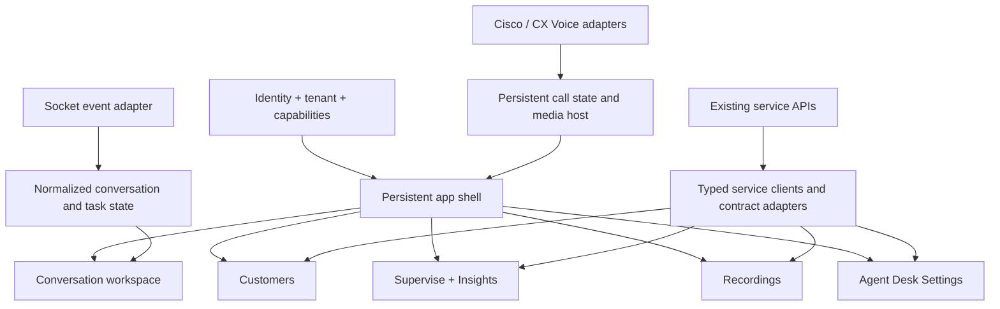

# Agent Desk 2.0 consolidation plan

Prepared 1 October 2026. This is a source-informed implementation and UX plan; it does not certify that the current application has production feature parity.

## 1. Product outcome and scope

Agent Desk 2.0 is one professional contact-centre application: one identity, one coherent navigation system, and access governed by the user's actual permissions. It consolidates the complete Unified Agent experience, the Unified Admin **Agent Desk Settings screen**, and the VRS experience. Existing backend services remain the integration targets.

The agent workspace is the centre of the product. Agents can handle several conversations on the same screen while retaining every channel, assistance, customer, voice, and wrap-up workflow. Supervisors, settings administrators, and recording users receive the relevant parts of the same application.

| Source         | Migration scope                                                                                                                                       |
| -------------- | ----------------------------------------------------------------------------------------------------------------------------------------------------- |
| Unified Agent  | All reachable agent and supervisor features, including feature-flagged flows, embedded integrations, preferences, dashboards, and telephony behavior. |
| Unified Admin  | Agent Desk Settings, all of its grouped fields, metadata, dependencies, validations, and save contract.                                               |
| VRS            | Recordings, audio/video players, filters, downloads, CSV export, audit logs, rules, archival, tag catalogue and recording tag assignment.             |
| New experience | Shared shell, unified capability model, multi-chat workspace, consistent UI components, coherent error/recovery UX.                                   |

Unified Admin's independent Languages and Translations editors live under `general-settings` in the source. They are outside this request's UI migration scope. The desk still consumes locale and translation services for its existing language support. Agent Desk 2.0 already has those editors; do not expose them as part of this release without a scope decision. Other Unified Admin product administration remains in that application.

**Release rule:** every in-scope legacy capability must have a mapped destination and verified acceptance evidence before its old front end is retired. Delivery can be incremental; feature retirement cannot be incremental by accident.

## 2. Source baselines and review limits

The three remote `develop` branches were fetched for this review. Unified Agent and Unified Admin local `develop` match the fetched heads. VRS local `develop` is older, so the latest fetched VRS source was inspected in an isolated archive without changing its checkout.

| Application    | Canonical source                                          | Commit                                                 |
| -------------- | --------------------------------------------------------- | ------------------------------------------------------ |
| Unified Agent  | `/Users/tlf/EF/unified-agent`, `origin/develop`           | `dfbd13e8504f1e2153a4c4ddaa775679f844092c`             |
| Unified Admin  | `/Users/tlf/EF/unified-admin/Frontend`, `origin/develop`  | `ee72cc3fb531576638f25caf745a9e67f3e02694`             |
| VRS            | `/Users/tlf/EF/VRS/front-end`, `origin/develop`           | `dcaf1c6328592ab9fbca8055a0230e764d4101f7`             |
| Agent Desk 2.0 | Current working tree, including existing uncommitted work | Base commit `a8c88ba214ab579d02c502c6cf315c336fd2c5c7` |

VRS `develop` now includes the tags merge dated 1 October. The existing `FEATURE_PARITY.md` reference to `master` plus a PTCL branch is stale for this plan. Use the pinned `develop` commit above, then track further develop changes through a migration delta log.

Discovery used the codebase knowledge graph, followed by source snippets, literal searches, route and configuration inspection. [SOURCE_INVENTORY.md](SOURCE_INVENTORY.md) records the discovered implementation surfaces and protocol names. The highest-risk behavior was inspected in the conversation, socket, SIP, Finesse, permission, settings, and VRS modules. A graph inventory does not prove that every branch of every function works: deployed integrations and full workflow execution remain delivery gates.

The [Claude multi-chat reference](https://claude.ai/artifact/5e01496e-df1a-47a8-8350-a5517349f1f4) was read on 1 October 2026 and is reconciled with the board in [MULTI_CHAT_REFERENCE.md](MULTI_CHAT_REFERENCE.md).

## 3. Initial source findings and implementation priorities

The findings below describe the checkout at the start of the 1 October review. Implementation has since progressed; [FEATURE_PARITY.md](FEATURE_PARITY.md) is the current evidence and remaining-work ledger.

Retain the existing React/TypeScript/Vite foundation, feature folders, TanStack Query, Zustand, Radix/shadcn primitives, runtime configuration, i18n and theme tokens. A second framework migration would add risk without serving the stated goal.

| Finding in the current source                                                                                                                                                                                    | Planning consequence                                                                                                                   |
| ---------------------------------------------------------------------------------------------------------------------------------------------------------------------------------------------------------------- | -------------------------------------------------------------------------------------------------------------------------------------- |
| The workspace has 1/2/3-pane selection and a board store.                                                                                                                                                        | Improve and verify the existing board; do not call pane count alone a complete multi-chat experience.                                  |
| The central permission registry omits named transfer, consult, conference, leave, wrap-up, history and recording-control permissions. The reviewed feature source does not reference their legacy scope strings. | Audit action authorization before expanding the UI. The generic `useScope` helper existing by itself is insufficient.                  |
| `RealtimePage` renders a fixed set of counts and a queue table.                                                                                                                                                  | Port the legacy dashboard's tabs, saved layouts, widget builder, visualizations, filters, thresholds, metric choices and AI generator. |
| `applySipEvent` handles a small set of registration/ringing/active/held/end states.                                                                                                                              | Build provider-specific state models for consult legs, conference participants, monitor roles, campaigns, recording and recovery.      |
| VRS and Unified Agent encode authorization differently.                                                                                                                                                          | Preserve resource/scope checks alongside VRS realm roles; an `admin` role must not imply every Unified Agent permission.               |
| Legacy supervisor HTTP methods still reference a Postman mock for queued, active-agent and active-bot chats.                                                                                                     | Confirm production endpoints and response shapes; source parity cannot mean shipping mock reporting.                                   |
| The Unified Admin settings route declares validation on PUT but no authentication middleware locally.                                                                                                            | Verify the mounted/global protection and enforce the settings manage scope on the backend.                                             |
| The old parity document has many completed marks and mixes unrelated enhancements with legacy parity.                                                                                                            | Keep those marks as prior claims, not this review's evidence. Revalidate at the pinned source baseline and separate enhancements.      |

User work in the current checkout is preserved. The initial review added this plan; the subsequent implementation follows it and records validation separately in the feature ledger.

## 4. Information architecture and permission-based entry

Organize the application around work, rather than the three old product names.

| Area           | Pages and workflows                                                                     | Entry requirement                                                                         |
| -------------- | --------------------------------------------------------------------------------------- | ----------------------------------------------------------------------------------------- |
| Workspace      | Conversations; request centre; outbound; customer/AI/app context; persistent voice dock | Explicit eligibility for the agent workspace and applicable conversation actions.         |
| Customers      | Phonebook, customer create/edit, labels, customer schema, voicemail, subscribed lists   | Individual resource scopes and desk configuration.                                        |
| Supervise      | Active conversations, queues, agent activity, recent history, announcements             | Supervisor scopes; retain permitted agent access to recent history and agent dashboards.  |
| Insights       | Summary, agent performance, team stats/detail, configurable realtime dashboard          | Source resource scopes, role context and feature flags.                                   |
| Recordings     | Media recordings, audit logs, rules, archival, tags                                     | VRS access roles plus independent download/export/tag permissions and deployment profile. |
| Administration | Agent Desk Settings                                                                     | `agent-desk-setting` view/configurations-view/manage, with manage required to save.       |
| Account        | Language, theme, density, allowed home page, password change                            | Signed-in user and relevant account policy.                                               |

One user can hold multiple capabilities. They should not choose an artificial role at login or log in again when changing areas. The default landing page is the saved authorized page, then an authorized role-appropriate fallback; users with no eligible pages receive a clear access message.

An admin-only login must not register SIP, connect an agent socket, or become Ready. A recording-only user may still carry the VRS `agent` realm role: **role name alone must not start an operational agent session**. Determine agent workspace eligibility and start the operational session deliberately. Keep that session alive through subsequent route changes until explicit logout or session termination.

### Authorization model

Use a shared capability registry for navigation, route guards, buttons, command handlers, data fetching and keyboard shortcuts. Effective access combines identity/resource permission, applicable record/team/tenant scope, deployment support, enabled feature, and the current workflow state. Backend authorization remains authoritative.

| Capability family                | Source permissions to preserve                                                                                                                                                |
| -------------------------------- | ----------------------------------------------------------------------------------------------------------------------------------------------------------------------------- |
| Customer data                    | `customer:view`, `manage`, `manage_in_conversation`, `view_pii`; inspect the legacy masking precedence and retain server data restrictions.                                   |
| Labels/schema                    | `customer-labels:assign_label`, `manage`; `customer-schema:view`, `manage`.                                                                                                   |
| Conversation commands            | `agent-conversation-control:view_initiate_chat`, `view_direct_transfer`, `view_consult`, `view_conference`, `view_leave_chat`, `view_wrap_up`.                                |
| History                          | `agent-conversation-control:view_history`, `view_history_active_customer`; distinguish current customer history from general browsing.                                        |
| Agent state                      | `state-change:manage_state_change`; state reasons and MRD-specific restrictions.                                                                                              |
| Pull mode                        | `subscribed-list:view`, `manage`.                                                                                                                                             |
| Supervision/insights             | `supervisor:view_all`, `agent-dashboard:view`, plus own-agent versus supervised-team data scope.                                                                              |
| Recording controls during a call | `call_recording_control:manage_call_recording_control` and provider/current-call support.                                                                                     |
| Agent Desk Settings              | `agent-desk-setting:view`, `configurations-view`, `manage`.                                                                                                                   |
| VRS                              | `admin`, `supervisor`, `agent`; independent `download`, `export`, `viewtag`, `evaluatetag`. Tag catalogue management is admin-only; recording assignment needs `evaluatetag`. |

Preserve VRS's role hierarchy within VRS. Preserve the CISCO/EFCX/other profile rules independently of agent telephony selection. Hiding a navigation item is not a security boundary: deep links, media URLs, export requests and commands must obey the same access policy.

Distinguish unauthenticated/expired identity from a service-specific 401 or 403. Refresh once for genuine expiry; a VRS audience incompatibility or forbidden settings request should not repeatedly log an otherwise valid agent out of an active conversation. Clear user/tenant caches on logout and identity changes. Permission loss must cancel forbidden queries and remove sensitive content.

## 5. Professional UI and UX direction

Design a calm, efficient workstation for prolonged use. Give operational state and customer content the strongest hierarchy. Use restrained accent colour, clear typography, consistent spacing, quiet separators and limited shadows. Prefer practical density over oversized cards. Avoid decorative gradients, excessive rounding, and repeated nested panels in the work area.

### Shared visual language

| Element       | Proposed specification                                                                                                                               |
| ------------- | ---------------------------------------------------------------------------------------------------------------------------------------------------- |
| Typography    | One legible sans-serif family; body 14–16 px, secondary labels 12–13 px, page titles 20–24 px. Tabular figures for durations and counts.             |
| Spacing       | 4 px scale, generally 8/12/16/24 px. Dense tables and comfortable forms share the same tokens.                                                       |
| Surfaces      | Neutral page background, clean content surfaces, subtle borders; 6–10 px control radii and 10–12 px panel radii as initial design values.            |
| Colour        | One brand accent for selection/action; semantic success/warning/error plus text or icon meaning. All tokens support light/dark and tenant branding.  |
| Controls      | Consistent 36–40 px desktop controls; generous touch targets in mobile layouts. Icon-only actions have accessible names and tooltips.                |
| Tables        | Clear headers, restrained row separators, sticky useful columns, controlled column visibility/reorder/resize, meaningful sort and paging.            |
| Feedback      | Inline errors for actionable problems; restrained toasts for completed work; durable banners for connection/session incidents.                       |
| Accessibility | Target WCAG 2.2 AA; keyboard workflows, visible focus, contrast, reduced motion, readable zoom and screen-reader semantics. Validate RTL throughout. |

Use the existing component system, owned by the project, for page headers, filters, tables, forms, dialogs, empty/error states, status chips and timelines. Components need documented states: loading, empty, unauthorized, disabled-with-reason, stale/reconnecting, error/retry, and success.

### Application shell

Use a compact primary sidebar, expandable labels, and a slim top bar. Keep agent/MRD state and connection status visible; place user preferences and logout consistently. Group secondary items within their domain. Preserve the conversation workspace while viewing Customers, Supervise or Recordings. Avoid full-page reloads as a normal navigation strategy.

Voice controls live in a persistent dock showing the customer, call leg, duration, hold/mute/recording state, and relevant actions. Expanded video/conference UI uses its own workspace surface. A settings editor should not inherit agent-only call/request clutter.

### Screen-specific experience

- **Customers:** saved filters, search and schema-driven columns; preview in a drawer; create/edit with grouped fields and clear validation; channel actions stay beside the right identifier.
- **Supervise:** meaningful filters for teams, secondary supervisors, queues, channels, agents/bots and labels; stable rows during refresh; visible data age and connection state; monitoring opens the intended conversation context.
- **Insights:** preserve Grafana and the custom dashboard as distinct supported experiences. Show loading/error/retry around embeds; keep dashboard authoring separate from normal monitoring.
- **Recordings:** full-width table with expandable call legs, applied-filter summary and advanced search; playback and tags stay in context; downloads/export have distinct permissions and progress/error feedback.
- **Agent Desk Settings:** section navigation, plain descriptions, units beside numbers, dependency-aware controls, sticky Save/Discard, dirty-state feedback, read-only mode and unsaved-navigation protection. Separate tenant-wide configuration from personal preferences.

### Design gate before broad implementation

Produce clickable prototypes for login/2FA, a two-chat workspace, email reply, consult/conference, customer linking, supervisor monitoring, recording playback/filtering, and Agent Desk Settings. Validate light/dark, dense/comfortable and RTL with realistic data. Observe agents and supervisors doing actual tasks. Approval should assess speed, clarity and mistakes as well as appearance.

## 6. Multi-chat workspace

Start with a focus view and a two-pane split view. Make three panes available when actual pane width permits readable content; do not squeeze three panes onto every desktop. Visible panes and the backend's maximum concurrent tasks are separate limits.

```text
Primary nav | Conversation rail | Conversation A | Conversation B | Context drawer
            | unread + SLA      | timeline       | timeline       | Customer
            | channel + preview | channel choice | channel choice | AI / Knowledge
            | active/paused     | composer       | composer       | Apps / History
                            Persistent voice dock / incoming request centre
```

At ordinary laptop widths, default to one or two panes with a collapsible conversation rail/context drawer. Three panes need a wide monitor. Initial minimum pane width is approximately 360–420 px, to be tested with email and attachments. Below the desktop breakpoint, use list → conversation → context navigation while keeping drafts and the call dock intact. At 200% zoom, switch layout according to available content width.

### Required interaction behavior

1. Opening a chat focuses an existing pane if it is already open. Otherwise it uses an empty or deliberately selected pane. New arrivals must not replace a draft the agent is typing.
2. Agents can choose pane count, focus a conversation, reorder or pin panes, collapse the rail, and open context for a chosen conversation. Preserve preference for layout, not a stale entitlement to old conversations.
3. Removing a pane only removes its presentation. **Leave conversation**, **end call**, and **apply wrap-up** are distinct server commands with their own access and state rules.
4. Every composer makes the recipient, channel/from address, public reply versus whisper/private reply, and any quoted message obvious. Send always uses that pane's identity.
5. Draft text, formatting, attachments/upload progress, email recipients, quoted/edit target, suggestion selection, channel session and scroll position are isolated by conversation and where needed channel session. They survive pane movement and in-app navigation.
6. A shared context drawer is explicitly anchored to its conversation. If its form is dirty, switching focus cannot silently make Save act on another customer.
7. Incoming requests use a dedicated request centre with accept/skip/reject and configured auto-answer. Cancel pending auto-answer immediately when a task is revoked or the session ends.
8. Read receipts depend on visibility, focus and message visibility rules. Merely rendering a hidden pane must not mark it read. Scrolling up preserves position when new messages arrive and offers a “new messages” indicator.
9. SLA, wrap-up and hold timers derive from source/server rules and recovered timestamps. The current board's 60/120-second visual waiting thresholds must not substitute for configurable SLA behavior.
10. Connection loss prevents unsupported sends and shows recovery status without destroying drafts. Reconnect restores authoritative conversations, roles, sessions, timers and delivery state without duplicate activity.
11. Assisted, monitored and whispered conversations show their participant role. Composer/action eligibility reacts to role changes and missing primary participants.
12. Pop-out is an optional advanced mode. Use one operational session owner with controlled synchronization; do not create duplicate sockets, independent task acceptance, or duplicate telephony registration. Include close/rejoin and permission-change behavior before enabling it.

Suggested state separation:

| State                                                  | Owner                                                                           |
| ------------------------------------------------------ | ------------------------------------------------------------------------------- |
| Identity, tenant and capabilities                      | Shared authentication core.                                                     |
| Conversation/messages/participants/channel sessions    | Normalized realtime workspace model, keyed by tenant and conversation.          |
| Task lifecycle/SLA/wrap-up/hold                        | Domain state plus recovered server times; independent of pane mount.            |
| Draft, email fields, reply/edit target and attachments | Conversation/channel-specific composer store.                                   |
| Pane layout, focus and context anchor                  | Board/UI store, separate from task lifecycle.                                   |
| Calls, consult legs, recording and media streams       | Persistent provider-specific voice state.                                       |
| Customer/history/reporting/settings/recordings queries | TanStack Query with tenant, user/data-scope and complete filters in query keys. |

## 7. Base architecture

Keep the current feature architecture and strengthen its boundaries.

```text
src/
  app/                 bootstrap, providers, router, persistent shell, navigation
  core/
    auth/              identity, refresh, capabilities, guards
    api/               service clients, contracts, errors, cancellation
    tenant/            tenant resolution and branding
    agent-settings/    grouped settings adapter and feature availability
    realtime/          socket lifecycle, typed event envelope and dispatch
    telephony/         shared provider interface and media lifecycle
    integrations/      trusted CRM/embedded-app bridge contract (proposed)
    i18n/ theme/ storage/ notifications/
  features/
    auth/ workspace/ voice/ customers/ supervise/ insights/ recordings/ admin/
  components/          owned primitives and common page/form/table composites
  shared/              pure helpers and reusable hooks
  config/              runtime schema and deployment profile
```

Dependencies flow from app to features to core/shared/components/config. Features expose public APIs rather than importing another feature's internals. Put view-independent state transitions in domain models; avoid recreating legacy giant UI components or a single global shared service.



### Integration rules

- One session coordinator controls identity restoration, permitted operational startup, reconnect, media registration and cleanup. Providers remain mounted above feature routes.
- Enumerate socket server events, client commands, CIM names and acknowledgements. Retain exact wire spelling, including legacy spellings. Validate payloads at adapters and document tolerant handling for known response variants.
- Normalize messages by id; reconcile optimistic sends with echoed messages and delivery notifications. Recover subscription snapshots and timer state. Define behavior for duplicates, reordered events, unknown messages and removed participants.
- Keep customer messages, whispers, suggestion events, system notifications and call activities semantically distinct. HTML/email content requires safe rendering; unsupported content needs an explicit fallback rather than being silently dropped.
- Define a telephony provider interface with declared capabilities, then separate Cisco and CX Voice reducers. Retain necessary wrapper assets behind the adapter while parity is verified. A shared generic call reducer cannot replace their different payloads and state flows.
- Maintain one media host across navigation; clean up streams, listeners, timers and object URLs deliberately. Call controls target the correct parent/consult leg and recording owner.
- Use typed service adapters for agent-manager, Unified Admin, conversation/customer services, reporting, file-engine, VRS, Grafana and voice tenant services. Preserve headers and runtime endpoint mapping. Do not silently replace production endpoints with guessed contracts.
- Namespace persisted data by tenant and user. Keep layout preferences separate from authentication and sensitive conversation data. Avoid persisting customer messages or drafts across user sessions without an agreed policy.
- Preserve Finesse gadget and CRM SSO, allowed frame parents, deployment base paths, runtime host rewrites and legacy deep-link mappings. Strip sensitive login parameters after consumption; validate CRM message origins and payloads while preserving event contracts.
- Add error boundaries per product area. A recording-player or embedded-app error must not destroy the agent workspace.

## 8. Feature parity requirements

These groups are implementation requirements. Each must be expanded into individual ledger entries with source path/symbol, permission/flag/profile, new destination, API/event contract, test case, and verification status. A grouped row cannot be marked complete while a subbehavior remains unresolved.

### Unified Agent — identity and platform

| ID     | Required behavior                                                                    | Primary source surface / acceptance focus                                                           |
| ------ | ------------------------------------------------------------------------------------ | --------------------------------------------------------------------------------------------------- |
| UA-P01 | Runtime config load/validation, host mapping, tenant logo, loading failure and retry | `appConfig.service`, settings utilities, bootstrap; malformed/unavailable config and branded retry. |
| UA-P02 | Username/password login and server error handling                                    | `login`; successful, rejected and unavailable-backend flows.                                        |
| UA-P03 | App/QR-secret, SMS, email and RSA 2FA                                                | `login`; setup/challenge/confirm/resend/countdown and retry limits.                                 |
| UA-P04 | Forced and voluntary password change, policy rules, expiry warning                   | `change-password-dialog`, login/session; preserve required steps.                                   |
| UA-P05 | Finesse gadget SSO, standalone SSO and HA behavior                                   | Login/config/Finesse; UCCE and UCCX, primary failure and secondary recovery.                        |
| UA-P06 | CRM SSO and conversation-switch events                                               | Login/CRM bridge; embedded and standalone contexts.                                                 |
| UA-P07 | Refresh, reload recovery, forced disconnect, duplicate-login removal and logout      | Interceptor/socket; no refresh loops or stale tasks after identity change.                          |
| UA-P08 | Global/MRD state, Ready/Not Ready/Logout reasons and timers                          | Header/socket/Finesse; confirm provider-to-MRD synchronization.                                     |
| UA-P09 | Inactivity warning/continue/logout with call, visibility and focus behavior          | `inactivity.service`; verify source semantics with active/held/consult calls.                       |
| UA-P10 | Languages, fallback translations, RTL, theme, compact view and allowed home page     | i18n/config/header/preferences; retain legacy language codes.                                       |
| UA-P11 | Browser sounds/notifications and supplied FCM key behavior                           | Sounds/notifications/FCM; denied permissions and revoked requests.                                  |
| UA-P12 | Analytics events and runtime/deployment/embedding contracts                          | Index/login/Docker; preserve relevant events without credentials/customer content.                  |

### Unified Agent — conversation workspace

| ID     | Required behavior                                                                     | Primary source surface / acceptance focus                                           |
| ------ | ------------------------------------------------------------------------------------- | ----------------------------------------------------------------------------------- |
| UA-C01 | Push, pull, consult and external voice task requests; accept/skip/reject              | Notifications/socket/pull mode; correct role and task subscription.                 |
| UA-C02 | Auto-answer delay and revoke cancellation                                             | Socket; no acceptance of a revoked task.                                            |
| UA-C03 | Active conversation rail, unread counts, channel icons, latest preview and SLA        | Chats/socket; independent updates across visible/hidden panes.                      |
| UA-C04 | Subscribe/unsubscribe/recover topic data and participant roles                        | Socket; PRIMARY/ASSISTANT/WHISPER/SILENT_MONITOR.                                   |
| UA-C05 | Messages/history paging and chronological merging                                     | Interactions/GraphQL/messages; pagination without duplicates or scroll jumps.       |
| UA-C06 | Plain/markdown/link/url and rich buttons/carousels/lists                              | Message templates/models; all source payload variants and interactions.             |
| UA-C07 | Image/video/audio/voice/file/sticker/location/contact/custom content                  | Message templates/file preview/audio; preview/download and unavailable files.       |
| UA-C08 | Form data, conversation data, system notifications, wrap-up and scheduled activities  | Message components/socket; preserve meaning and source metadata.                    |
| UA-C09 | Delivery states, seen receipts, typing, failed-message retry and edit reconciliation  | Socket/interactions; duplicate echoes and UPDATE intent.                            |
| UA-C10 | Formatting, emoji, file upload, spell-check dictionaries and suggestions              | Composer/spellcheck; configured on/off behavior and cleanup.                        |
| UA-C11 | Canned/quick replies, slash search, tags and management/persistence                   | Quick replies/cache; source feature flag.                                           |
| UA-C12 | Channel-session selection and outbound from-channel identity                          | Interactions/channel selector; never send to a pane's previous recipient/session.   |
| UA-C13 | Quote/reply/edit mode and channel-specific eligibility                                | Interactions; quoted-only actions for relevant social/review channels.              |
| UA-C14 | Public social reply/private reply, comment like/hide/delete, full-post view           | Comment/messages; platform and participant restrictions.                            |
| UA-C15 | Email threads, expansion/full-thread view, reply/reply-all/forward                    | Email activity/composer; exact recipient semantics.                                 |
| UA-C16 | Email To/CC/BCC, signatures, attachments, inline images, from-channel and cold email  | Email composer/outbound; safe HTML and clear send context.                          |
| UA-C17 | AI/bot suggestions, confidence, knowledge search/source send                          | Interactions/customer info; source configuration and failures.                      |
| UA-C18 | Text refine, accept/discard and error handling                                        | AI refine/interactions; response belongs to the initiating draft.                   |
| UA-C19 | Conversation sentiment/summary/data, copy actions and customer form data              | Customer info/conversation-data; isolate per conversation.                          |
| UA-C20 | Customer view/edit, identifiers, PII masking and active channel details               | Customer info/contact card; general versus in-conversation edit scopes.             |
| UA-C21 | Profile matching, suggestions, view-all matches, link/merge and session move          | Customer info/link dialog/phonebook; confirmation and correct customer association. |
| UA-C22 | History permissions and read-only/fake conversation contexts                          | Interactions/socket; no live-only commands while browsing history.                  |
| UA-C23 | Direct transfer to agent/queue and direct conference                                  | Interactions/socket; permission, primary role, pending/failure/acknowledged states. |
| UA-C24 | Consult agent/queue, consult transfer/conference and named assistance                 | Interactions/socket; assistant roles, agent eligibility and task replacement.       |
| UA-C25 | Whisper, silent monitor, barge-in and role transitions                                | Supervision/interactions/socket; no accidental public whisper send.                 |
| UA-C26 | Hand raise/lower, notifications and SLA-expiry interaction                            | Socket/interactions; correct conversation and duplicate-notification suppression.   |
| UA-C27 | Pause/resume with configured hold spans and recovered timer                           | Socket/interactions/hold timers; SLA interaction and auto-resume semantics.         |
| UA-C28 | Wrap-up categories/options/search paging, multiple-choice limits, notes and selection | Wrap-up form; do not truncate results or hardcode schema limits.                    |
| UA-C29 | Wrap-up apply/skip/leave, timer expiry and server unsubscribe reasons                 | Interactions/socket; preserve channel data and prevent false completed state.       |
| UA-C30 | Embedded apps, external gadget events, switching/loading and secure video link        | Interactions/customer info; allowed origin/frame/media behavior.                    |
| UA-C31 | CRM lifecycle/state/task/wrap-up/role/channel/theme/conversation events               | CRM service; direction and exact event casing documented in source inventory.       |
| UA-C32 | Responsive call/chat/context layouts, fullscreen and picture-in-picture               | Interactions/call controls; remain usable with drafts and media active.             |

Multi-pane layout is an enhancement on top of UA-C01–C32. All of these requirements must work in focus and split modes.

### Unified Agent — voice

| ID     | Required behavior                                                                  | Acceptance focus                                                            |
| ------ | ---------------------------------------------------------------------------------- | --------------------------------------------------------------------------- |
| UA-V01 | CX Voice tenant/WSS/domain/extension discovery, registration and media permissions | No extension, permission denied, retry, invalid state and domain mismatch.  |
| UA-V02 | Inbound/outbound answer/reject/skip/end                                            | Correct call/task/channel association and end reason.                       |
| UA-V03 | Hold/resume/mute/unmute and duration/hold timers                                   | Main and consult legs; conference-specific behavior.                        |
| UA-V04 | DTMF for main and consult calls                                                    | Target correct dialog with exact wrapper command.                           |
| UA-V05 | Blind agent/queue/external transfer                                                | Source number/service identifier rules and pending failures.                |
| UA-V06 | Agent/queue/external consult then transfer or conference                           | Initiator and consulted-user flows; ending either leg.                      |
| UA-V07 | Conference participants, holds, customer/participant departure and cleanup         | Multi-party state and end reasons.                                          |
| UA-V08 | Monitor, whisper/barge and supervisory call types                                  | Correct role/media/MRD transitions.                                         |
| UA-V09 | Progressive/predictive/preview campaigns                                           | Source auto-answer rules; preview is not auto-answered.                     |
| UA-V10 | Voice and WebRTC video, local camera, streams, screen share and conversion         | Device permission changes and cleanup during navigation.                    |
| UA-V11 | Pause/resume call recording and recording-state events                             | Permission; parent/consult leg ownership; no optimistic false confirmation. |
| UA-V12 | Reload/reconnect recovery, active-task lookup and cached dialogs                   | SIP main, consult, conference, outbound and monitor states.                 |
| UA-V13 | Cisco Finesse UCCE/UCCX login, callbacks and presence                              | Gadget/standalone SSO, reasons and HA host selection.                       |
| UA-V14 | Cisco dialog states, RONA, ANI/customer lookup and call variables                  | Consult/drop/transfer/conference cases and MRD synchronization.             |
| UA-V15 | Cisco command set and supported media/secure-link integrations                     | Compare every CTI wrapper command and event with the source.                |
| UA-V16 | Voicemail inbox, unread/read/filter/sort, playback and customer conversation       | Count updates and history/PII rules.                                        |

Treat `sip.service.ts`, `finesse.service.ts` and CTI wrappers as behavior specifications. They must be decomposed into scenarios; copying scripts and displaying Answer/Hold is not voice parity.

### Unified Agent — customers, outbound and supervision

| ID     | Required behavior                                                               | Acceptance focus                                                                               |
| ------ | ------------------------------------------------------------------------------- | ---------------------------------------------------------------------------------------------- |
| UA-O01 | Phonebook schema columns, column preferences/order, sort and paging             | Schema changes, preferences and appropriate data scope.                                        |
| UA-O02 | Field search, multi-label filters and saved advanced filters                    | Filter persistence and clear/reset behavior.                                                   |
| UA-O03 | Customer create/edit, repeated identifiers, field types and validations         | Required, length, type, PII and channel-identifier metadata.                                   |
| UA-O04 | Customer schema CRUD/order and label CRUD/assignment                            | Separate view/manage/assign permissions.                                                       |
| UA-O05 | Phonebook linking mode and row actions for chat/voice/SMS/WhatsApp/email        | Correct identifier/from-channel and duplicate-customer resolution.                             |
| UA-O06 | Outbound panel, contact autocomplete, dial pad/prefix handling and manual calls | Zero/one/multiple matches, unknown customer and source number normalization.                   |
| UA-O07 | Opt-out suppression, admin DNC and calling compliance                           | All initiation paths; failed compliance check does not place the call.                         |
| UA-O08 | Outbound SMS, send-and-close and cold email                                     | From channel, persisted draft behavior and success/error feedback.                             |
| UA-O09 | Subscribed lists, previews, pull requests and join/update/remove                | Realtime reconciliation, view/manage and source sorting.                                       |
| UA-O10 | Quick links search, role visibility, pin/unpin and preference persistence       | Keep per-user behavior and safe navigation.                                                    |
| UA-S01 | Announcements create/update/delete, recipients, expiry and seen state           | Supervisor and agent experiences; source notification/QM integration.                          |
| UA-S02 | Active agent/bot chats, filters, refresh and monitor/whisper                    | Secondary supervisors, queues, labels and oldest-first sorting.                                |
| UA-S03 | Queued conversations with preserved filters/sort/refresh                        | Real endpoint required. Re-queue is a separately tracked enhancement if not working in source. |
| UA-S04 | Agents/activity/MRD states and force Ready/logout actions                       | Edit permissions and supervised-team restrictions.                                             |
| UA-S05 | Recent conversation search, time/direction/channel filters, paging and history  | Source GraphQL contract and history scopes.                                                    |
| UA-S06 | Grafana summary, agent performance, team stats and team detail                  | Source filter parameters, permissions, loading/error/retry and embedding.                      |
| UA-S07 | Configurable realtime dashboard tabs/add/remove/rename and saved layout         | Preserve load/save/migration and active-tab behavior.                                          |
| UA-S08 | Grid/widget add/edit/remove/reorder, KPI/chart/table visualizations             | Metric metadata, filters, selected fields, duration formatting and thresholds.                 |
| UA-S09 | Team/agent/queue/MRD/bot resolution, polling and refresh intervals              | Own versus supervised context; scoped caching and unavailable data.                            |
| UA-S10 | AI widget generator, model initialization and config confirmation               | Feature gating, unsupported browser/model failure, validate generated config.                  |

### VRS

| ID     | Required behavior                                                               | Acceptance focus                                                                                                                                         |
| ------ | ------------------------------------------------------------------------------- | -------------------------------------------------------------------------------------------------------------------------------------------------------- |
| VRS-01 | One-login access with equivalent roles, agent restrictions and logout audit     | Confirm common realm/audience and data scoping before release.                                                                                           |
| VRS-02 | Recording table/count/refresh/sort/paging, columns reorder/resize/visibility    | CISCO/EFCX server paging, known array fallback, stable pagination.                                                                                       |
| VRS-03 | Correlated calls/multiple legs, archived/played markers and missing recordings  | Preserve leg identity and unavailable-media handling.                                                                                                    |
| VRS-04 | Agent id/name, calling/called number, duration/hold, wrap-up, direction filters | Agent-only filter restrictions and profile-specific fields.                                                                                              |
| VRS-05 | Call variable 1–10 key/value, tags, date/time and Date Within presets           | Exact request mapping, trimmed values and local-to-UTC conversion.                                                                                       |
| VRS-06 | Audio waveform, WAV peaks, play/pause, seek/±10s, mute/volume/speed/keyboard    | PCM/A-law/µ-law formats; loading/error; play audit.                                                                                                      |
| VRS-07 | Screen recording video, seek/buffer/fullscreen/speed/keyboard                   | Audio/video asset selection, no playable URL, cleanup.                                                                                                   |
| VRS-08 | WAV/MP3 download, filename, permissions and audit                               | `download` role independent of playback.                                                                                                                 |
| VRS-09 | Complete filtered CSV export and audit for success/failure                      | `export` role; full re-fetch/page traversal; source headers, date formats, BOM/phone preservation.                                                       |
| VRS-10 | Audit log list/filter/date/time/paging                                          | Actor/action/status and scoped results.                                                                                                                  |
| VRS-11 | Recording rules CRUD, scroll loading and drag/drop priority                     | Action/type/mask, screen capture, read-only capture-usage field, weekdays, from/to time and mask/time validation.                                        |
| VRS-12 | Archival enable/modes/schedule/SFTP and tenant configuration                    | External server IP, folder path, username/password, retention (1–364 days), copy time; EFCX tenant-aware create/update versus legacy singleton settings. |
| VRS-13 | Tag catalogue create/update/delete and validation/errors                        | Admin-only; existing recording references and failure behavior.                                                                                          |
| VRS-14 | Recording tag view/assign/unassign/filter/export                                | `viewtag` versus `evaluatetag`; CISCO/profile support and optimistic rollback.                                                                           |
| VRS-15 | All deployment-profile visibility, columns and request differences              | CISCO, EFCX and legacy profile; do not infer profile from voice provider.                                                                                |

### Unified Admin — exact Agent Desk Settings fields

Retain the grouped backend payload and unknown server fields when editing, while respecting the source's deliberate removal of deprecated telephony-location fields in `buildGroupedPayload`. Do not overwrite configuration with UI defaults when sections are unavailable or disabled. This table lists source form fields; deployment values must come from the backend, not example credentials in legacy source.

| Group                 | Fields to preserve                                                                                                                                                                                                                                                                                  |
| --------------------- | --------------------------------------------------------------------------------------------------------------------------------------------------------------------------------------------------------------------------------------------------------------------------------------------------- |
| Messaging composition | `isMessageFormattingEnabled`, `isTextRefineEnabled`, `isSpellCheckEnabled`, `isEmojisEnabled`, `isFileSharingEnabled`.                                                                                                                                                                              |
| Knowledge/AI          | `isKnowledgeBaseSearchEnabled`, `knowledgeBaseUrl`.                                                                                                                                                                                                                                                 |
| Voice/telephony       | `isVoicemailEnabled`, `isCallingComplianceEnabled`, `isCiscoEnabled`, `isCxVoiceEnabled`, `isWebRtcVideoEnabled`, nested `ciscoSettings`, nested `cxVoiceSettings`.                                                                                                                                 |
| Cisco settings        | `ssoBackendUrl`, `isGadget`, `isSecureLinkEnabled`, `boshUrl`, `subBoshUrl`, `callVariable`, `domain`, `subDomain`, `ctiParam`, `ctiParam2`, `finesseFlavor`, `ciscoCcMrd`, `finesseURLForAgent`, `isFinesseHaEnabled`, `secondaryFinesseUrl`, `ciscoServiceIdentifier`, `webRtcServiceIdentifier`. |
| CX Voice settings     | `autoCallAnswerTimer`, `sipMonitoringDn`, `sipExternalDn`, `cxVoiceMrd`, `extStatic`, `enableSipLogs`, `staticQueueTransferDn`.                                                                                                                                                                     |
| CRM integration       | `enableVoiceEventsForCrm`, `isCrmEventsEnabled`.                                                                                                                                                                                                                                                    |
| Conversation handling | `isAutoAnswerEnabled`, `autoAnswerDelay`, `isWrapUpEnabled`, `wrapUpTime`, `isConversationParticipantsEnabled`, `isShowActiveChannelsDataEnabled`, `holdConversation`, `isInactivityTimerEnabled`, `inactivityTimeoutSeconds`, `isOutboundSmsEnabled`, `isOutboundSmsSendandClose`, `prefixCode`.   |
| Workspace preferences | `dashboardRefreshTime`.                                                                                                                                                                                                                                                                             |

Required source rules: Cisco/CX mutually exclusive selection; metadata-driven text/boolean/select/password fields; static fields read-only; UCCE/UCCX choices; gadget and HA dependencies; KB URL required only when enabled; wrap-up integer 15–1800 seconds when enabled; inactivity integer 30–3600 seconds when enabled; hold spans 1–20 minutes and required selection; prefix validation; faithful units for millisecond conversation auto-answer/dashboard refresh and second-based campaign auto-answer/wrap-up/inactivity. Preserve source validation limits for fields whose templates/backend add further restrictions.

Save requires manage access, a valid dirty form, pending-state feedback and server confirmation. Discard returns to loaded server values. Settings changes must explain whether they apply immediately or require a new session; changing voice configuration must not silently re-register an active call.

## 9. Backend and deployment dependencies

| Dependency                                                              | Required proof / owner                                                                                                                                                                    |
| ----------------------------------------------------------------------- | ----------------------------------------------------------------------------------------------------------------------------------------------------------------------------------------- |
| Shared authentication for operational, settings-only and VRS-only users | Identity/agent-manager owner: these identities can authenticate without being enrolled in an agent session.                                                                               |
| VRS token acceptance and data scoping                                   | VRS/identity owners: same token works for permitted recordings/media/export; agent-only scope cannot be broadened through parameters.                                                     |
| Login/logout/action audit semantics                                     | VRS owner: preserve auditing when the old `/vrs/login` flow is replaced; identify an existing accepted hook or add an agreed contract.                                                    |
| Unified Admin settings write authorization                              | Admin owner: verify global/mounted middleware and require `agent-desk-setting:manage`; anonymous/wrong-scope writes rejected.                                                             |
| Production supervisor/reporting endpoints                               | Reporting owner: document actual queued/active-agent/active-bot/realtime metric endpoints and filters; remove Postman dependency.                                                         |
| Recording pagination/export/tag contracts                               | VRS owner: CISCO/EFCX paged shapes and stable export traversal, tag assignment/unassignment and permission enforcement.                                                                   |
| Voice tenant, extension, secrets and wrappers                           | Voice/identity owners: provider contracts, registration recovery, authorized access to secrets; remove dependence on a bundled hardcoded decryption passphrase through backend provision. |
| One ingress origin and embedding                                        | DevOps/integration owners: runtime base path, service routing, TLS/media, CSP/frame ancestors, CORS and trusted CRM origins.                                                              |
| Language/translation and file-engine compatibility                      | Admin/file-engine owners: existing settings/schema and new desk translation keys can coexist with deployed translations.                                                                  |

These are confirmation/integration tasks, not claims that the backend already provides them. Service unavailability should be isolated in the corresponding area; runtime bootstrap failure should offer retry and useful diagnostics.

## 10. Delivery sequence and acceptance gates

Each phase produces a reviewable UI and behavior evidence. Work may overlap once dependencies are settled, but passing a UI gate never substitutes for integration parity.

| Phase                        | Work                                                                                                                                                                                                                                             | Exit gate                                                                                                                      |
| ---------------------------- | ------------------------------------------------------------------------------------------------------------------------------------------------------------------------------------------------------------------------------------------------ | ------------------------------------------------------------------------------------------------------------------------------ |
| 0 — Baseline and contracts   | Freeze source heads; split requirement groups into atomic ledger entries; inventory routes/actions/settings/messages/events/wrappers; classify source defects, mocks and inactive flags; confirm API contracts and role/data-scope combinations. | Every source surface assigned; unresolved contracts have owners; no unclassified in-scope behavior.                            |
| 1 — Structure and design     | Audit existing foundation; persistent shell/session boundaries; capability registry; design tokens and common components; clickable critical-flow prototypes.                                                                                    | Role-specific navigation, responsive/RTL prototypes and clear keyboard behavior reviewed with agents/supervisors.              |
| 2 — Identity and settings    | Real auth/2FA/password/SSO/refresh; non-agent login; settings round trip and all field rules; scoped clients/audit integration spike.                                                                                                            | Agent, supervisor, settings-only and recording-only login verified against services; forbidden writes rejected.                |
| 3 — Messaging vertical slice | Task → subscription → two panes → send/delivery/seen → customer context → leave/wrap-up; reconnect/revoke and draft isolation.                                                                                                                   | Two simultaneous conversations pass recipient/channel/draft isolation and reconnect scenarios.                                 |
| 4 — Full conversation parity | All message types, social/email, history, AI/KB, links/merge, assistance/transfer/conference, monitor/whisper/barge, hold/wrap-up, CRM/embedded apps.                                                                                            | UA-C01–C32 mapped and verified in focus/split views; source scope denials verified.                                            |
| 5 — Voice parity             | CX and Cisco adapters/state models, all legs/campaigns/recording/media, recovery and persistent dock; voicemail.                                                                                                                                 | Provider/flavour/call-type matrix passes real integration; no duplicate session/media registration.                            |
| 6 — Customers and outbound   | Phonebook, forms/schema/labels, advanced filters/preferences, outbound/channel/prefix/compliance, subscribed lists/quick links/replies/announcements.                                                                                            | Every initiation path respects data/action scope, from-channel identity and compliance.                                        |
| 7 — Supervision and insights | Live/queued/agents/recent pages, Grafana, complete custom dashboard and AI authoring.                                                                                                                                                            | Production contracts and role/team filters verified; widget and layout parity demonstrated.                                    |
| 8 — VRS                      | All recording views/players/filters/export/audits/rules/archival/tags and profile rules.                                                                                                                                                         | Latest-develop parity verified across roles and profiles, including media and full export.                                     |
| 9 — Hardening and cutover    | Integration/accessibility/performance checks; develop-delta review; pilot; deployment/observability/rollback runbook.                                                                                                                            | Zero unresolved legacy omissions, no critical authorization or wrong-recipient defects, successful pilot and approved cutover. |

The critical path is backend identity/permissions, complete conversation lifecycle, provider voice parity, and real reporting contracts. Estimate effort after Phase 0 scenario counts and integration availability; a screen count is not a reliable estimate for this migration.

## 11. Verification and no-feature-loss controls

Create an atomic parity ledger with: ID, baseline commit, source path/symbol/template, user scenario, permission/data scope, flag/profile/provider, endpoint/event/payload, destination, implementation status, test/evidence link, owner, and unresolved issue. Use statuses such as inventoried, contract confirmed, implemented, mock verified, integration verified, and accepted. Do not collapse these into a single “done” tick.

Existing source bugs are retained as tracked behavior gaps, then resolved intentionally. An unfinished source re-queue action, new multi-tenancy mode, or new system-theme option must be labelled separately from legacy parity. An inactive legacy feature is still inventoried; its enabled configuration must be tested or explicitly accounted for before retirement.

### Required test matrix

| Dimension              | Scenarios                                                                                                                                                         |
| ---------------------- | ----------------------------------------------------------------------------------------------------------------------------------------------------------------- |
| Identity               | Agent, supervisor, settings-view, settings-manage, recording-only, combined capabilities, missing scope, malformed/expired session.                               |
| Recordings permissions | Playback-only, download-only entitlement, export entitlement, viewtag, evaluatetag, admin catalogue management; own/team/tenant scope.                            |
| Workspace              | Focus/two/three panes, draft movement, concurrent uploads/AI, active/paused/wrap-up, history, PRIMARY/ASSISTANT/WHISPER/SILENT_MONITOR.                           |
| Channel                | Each configured source channel and message type; email and social-specific commands; multiple sessions in one conversation.                                       |
| Telephony              | CX Voice and Cisco UCCE/UCCX; inbound/outbound/campaign/consult/transfer/conference/monitor; permission and HA/recovery variations.                               |
| Deployment             | CISCO/EFCX/legacy VRS, configured tenant, flags off/on, gadget/CRM/standalone, alternate base path.                                                               |
| UI                     | Light/dark, comfortable/compact, long text/data, RTL, keyboard, screen reader, zoom, laptop/wide screen/mobile.                                                   |
| Reliability            | Disconnect/reconnect, stale/reordered/duplicate events, task revoke, backend errors, audit failures, denied media permission, logout/permission loss mid-request. |

Use unit/scenario tests for domain transitions and permissions; adapter contract tests for actual payloads; Playwright for complete user workflows; deployed integration tests for SIP/Finesse/SSO/recordings; visual regression and usability sessions for UI. Mocks are useful evidence of frontend behavior, not production service compatibility.

Proposed performance budgets to validate in Phase 1: a send/control action visibly responds within 100 ms excluding network acknowledgement; no repeated long tasks over 50 ms during routine chat activity on the agreed test machine; bounded memory during a full agent shift; virtualized long histories/large tables; lazy load heavy voice/player/dashboard authoring modules. Record real baseline measurements before adopting absolute page-load targets.

Before cutover, compare each frozen `develop` head with the then-current develop branch and triage new behavior. Run a pilot with representative agent, supervisor, settings and recordings identities. Keep the previous front ends available for rollback until the parity ledger, integration evidence and operational runbook are accepted.

## 12. First implementation increment

Start with the capability audit and a polished persistent shell, followed by one complete two-chat messaging flow. In the same increment, prove settings-only and recording-only authentication plus a real VRS read call. This resolves the highest architectural risks early and makes the UI direction tangible before the broad feature migration.

The expected review deliverable is a working shell and two-chat flow, clickable designs for the remaining critical screens, the atomic source parity ledger, and explicit backend contract decisions. The finished release includes all in-scope features; the first increment is only the first validation milestone.
